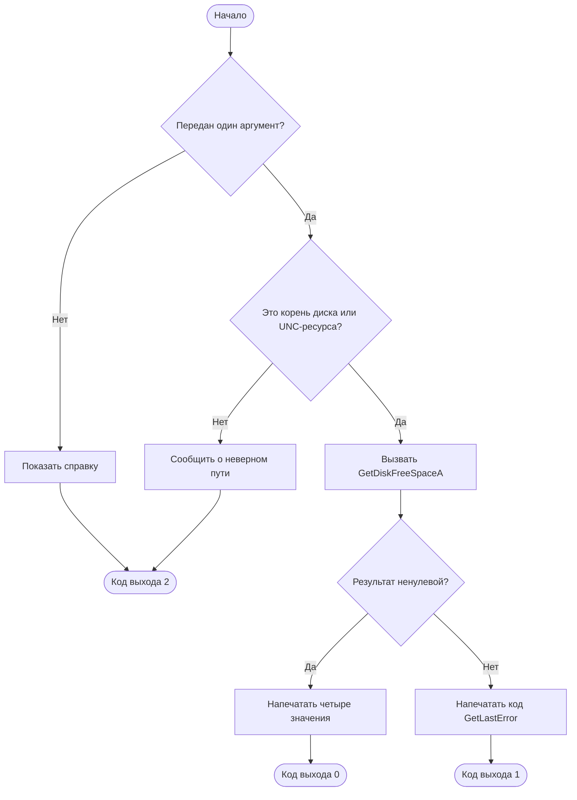
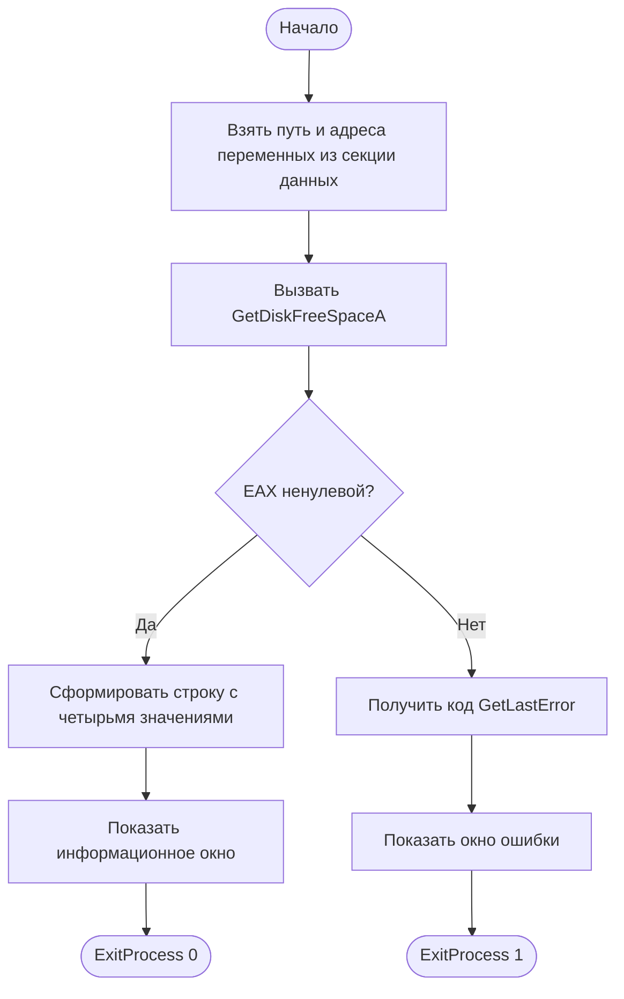
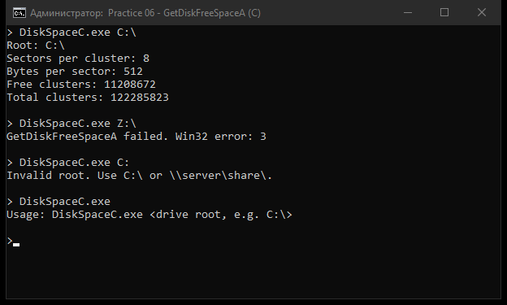
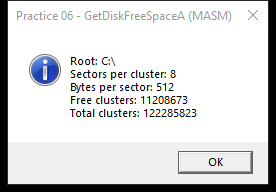
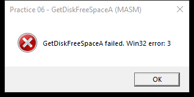

# Практическая работа №6. Получение сведений о дисковом пространстве

Студент Рункин · Вариант 12

## Задание

Реализовать вызов `GetDiskFreeSpaceA` в двух программах. Программа на C принимает корень диска в командной строке, проверяет параметры и сообщает о результате. Программа на ассемблере x86 получает корень из секции данных, проверяет результат в регистре EAX и выводит сообщение через `MessageBoxA`.

Функция получает корневой путь с конечной обратной косой чертой и адреса четырёх переменных типа `DWORD`. При успехе в них возвращается количество секторов в кластере, байтов в секторе, свободных кластеров и всех кластеров. Нулевой результат означает ошибку, код которой возвращает `GetLastError`. [Документация GetDiskFreeSpaceA](https://learn.microsoft.com/en-us/windows/win32/api/fileapi/nf-fileapi-getdiskfreespacea)

## Сборка и запуск

Откройте `SP_A_06.sln` в Visual Studio 2022, выберите **Release | Win32** и соберите решение. В `bin\Win32\Release` появятся `DiskSpaceC.exe` и `DiskSpaceAsm.exe`. Готовые файлы можно взять в [executables](executables/).

Команды для `cmd.exe` из каталога с исполняемыми файлами.

```bat
DiskSpaceC.exe C:\
DiskSpaceC.exe Z:\
DiskSpaceC.exe C:
DiskSpaceC.exe
start "" /wait DiskSpaceAsm.exe
```

Для проверки ошибки API подставьте букву отсутствующего диска, если `Z:\` используется. В MASM корень по умолчанию `C:\`. Чтобы проверить ветку ошибки, поменяйте `rootPath` на букву отсутствующего диска и пересоберите проект.

## Алгоритмы

### Программа на C



### Программа на ассемблере



## Листинги

- [Исходный текст на C](DiskSpace.c)
- [Исходный текст на ассемблере MASM x86](DiskSpace.asm)

## Результаты запуска

| Сценарий | Результат |
| --- | --- |
| C, корень `C:\` | Вывод четырёх значений, код выхода 0 |
| C, отсутствующий диск | Сообщение об ошибке Win32, код выхода 1 |
| C, путь `C:` без конечной обратной косой черты | Сообщение о неверном пути, код выхода 2 |
| C, запуск без параметра | Справка, код выхода 2 |
| MASM, корень `C:\` | Информационное окно с четырьмя значениями, код выхода 0 |
| MASM, корень отсутствующего диска в секции данных | Окно с кодом ошибки Win32, код выхода 1 |

**C.** Успешный запуск и обработка ошибок в командной строке.



**MASM.** Информационное окно для диска C и окно ошибки для отсутствующего диска.





Обе программы получили геометрию тома через один и тот же вызов Win32. Текущие числа свободных кластеров зависят от диска и работы системы.
